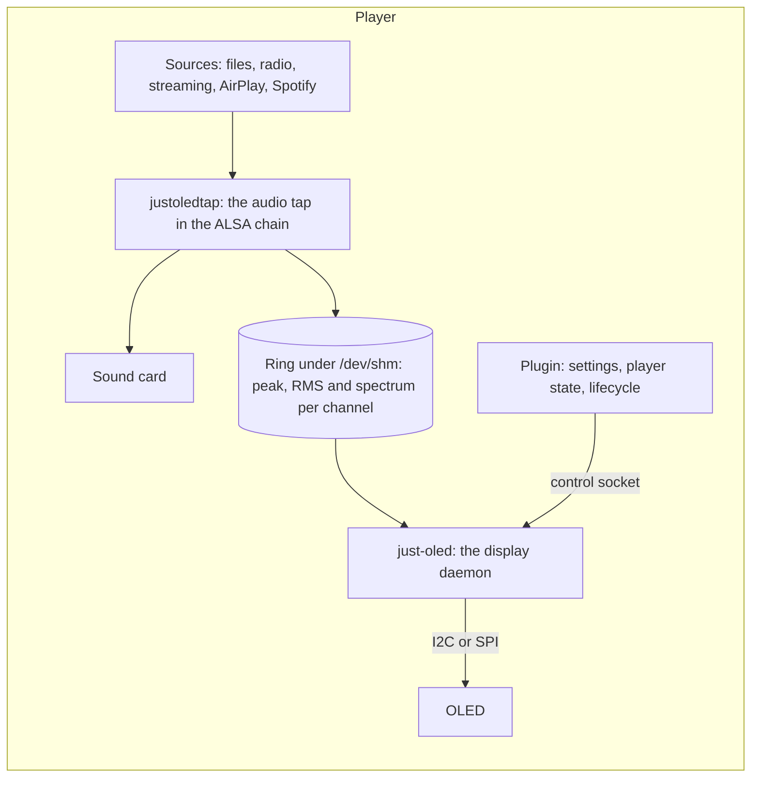

# Just OLED

Spectrum, VU bars, the track and a clock on a small OLED or TFT LCD, moving with the music on a Volumio player. A Volumio plugin written in Rust for the whole family of I2C and SPI OLED modules, monochrome, greyscale and colour, and the small SPI TFT LCDs: an audio tap in the player's ALSA chain measures every source, files, radio, streaming, AirPlay and Spotify alike, without touching the sound; a small daemon draws the pages, shows the player's state, a standby clock and date, and says when the system boots, restarts and shuts down.

The face is the user's: the spectrum, the stereo spectrum, the spectrum with left and right levels, the levels alone, the track alone in larger type, or the spectrum across the whole panel; the track's time played, remaining or none; the sample rate and bit depth; peak marks; a meter gain for quiet and loud recordings. Standby shows the time and date in the formats the user picks, with the player's address, and goes dark after a chosen while. Every page lays itself out for the panel it is on, from a 128x32 strip to a 256x64 grey, a 128x128 colour module or a 320x240 TFT.

The workspace version is **0.1.8**: the tap, the drivers for the one-bit, grey and colour OLED controllers and the TFT LCDs, the pages and the plugin are in; two modules (the Waveshare 1.5" RGB, SSD1351, and a 2.42" SSD1309) have been seen working, the Waveshare 2" ST7789 is on the bench, the rest are driven from the data sheets and wait for one. The [wiki](https://github.com/foonerd/just_oled/wiki) says what is verified on a module and what is described from the data sheet.

## Get it

Download the plugin zip from the [releases](https://github.com/foonerd/just_oled/releases) and install it by hand as the [Quick Start](https://github.com/foonerd/just_oled/wiki/Quick-Start) shows: `miniunzip` into a folder on the player, `volumio plugin install` from it. Once it has been through field testing and Volumio's review it will be in the plugin store. The wiki has the [wiring](https://github.com/foonerd/just_oled/wiki/Wiring) with a drawing per module, the [supported displays](https://github.com/foonerd/just_oled/wiki/Displays), every [setting](https://github.com/foonerd/just_oled/wiki/Settings) and the [troubleshooting](https://github.com/foonerd/just_oled/wiki/Troubleshooting) page.

| Player | Volumio 4 on a Raspberry Pi Zero 2 W, 3, 4 or 5 (32- or 64-bit image), or a PC with a USB I2C adapter. |
| --- | --- |
| Display | Any module on a controller the catalogue names (`just-oled --list`): SSD1306, SSD1309, SSD1315, SSD1305, SH1106, SH1107, SSD1327, SSD1322, SSD1325, SH1122, SSD1362, CH1120, and the colour SSD1331, SSD1351 and SSD1357; see [Displays](https://github.com/foonerd/just_oled/wiki/Displays). |
| Wiring | I2C: four wires. SPI: seven wires, with data/command and reset on two GPIOs. 3.3 V unless the module says otherwise. |

## What is in the box



| Part | Where | What it does |
| --- | --- | --- |
| `justoled` | `justoled/` | The library behind both artefacts. With the `tap` feature: the measurements, the spectrum bank and the ring. With the `display` feature: the catalogue of controllers and panels, the I2C and SPI transports, the framebuffers in each controller's pixel format, the pages. The one external crate is `libc`. |
| `justoled-tap` | `bins/justoled-tap` | The ALSA PCM plugin (`libjustoledtap.so`, `type justoledtap`): heads the player's chain, passes every stream through byte for byte, and measures it on a thread of its own. |
| `just-oled` | `bins/just-oled` | The daemon: reads the ring and the player's state, draws the pages, serves the control socket; `--list`, `--probe`, `--test`, `--say` and `--render` on the command line. |
| The plugin | `plugin/` | The Volumio plugin: `index.js` and the settings page at the root, the ALSA contribution template under `alsa/`, the tap under `alsa-lib/<arch>/`, the daemon under `bin/<arch>/`, the service unit under `systemd/`, the launcher and the architecture probe under `scripts/`. |

## Build

The toolchain is pinned by `rust-toolchain.toml`; the cross linkers are named in `.cargo/config.toml` (`gcc-arm-linux-gnueabihf`, `gcc-aarch64-linux-gnu`).

```sh
scripts/check.sh     # format, clippy, tests, docs, dependency gate, glibc ceiling, plugin files and tests
scripts/ship.sh      # the daemon and the tap for armhf, arm64 and amd64 into bin/ and lib/
scripts/package.sh   # the plugin zip into dist/
```

Every shipped binary must load on Volumio's glibc 2.36; `ship.sh` refuses one that does not. `check.sh` refuses a lock file that names any crate beyond the workspace and `libc`. Without the cross compilers on the machine, the builder image of `scripts/builder/Dockerfile` has everything:

```sh
docker build -t just-oled-builder -f scripts/builder/Dockerfile .
docker run --rm --user "$(id -u):$(id -g)" -v "$PWD:/work" -w /work just-oled-builder sh -c 'scripts/ship.sh && scripts/package.sh'
```

## License

MIT. The audio tap descends from the tap of [glass](https://github.com/foonerd/glass), MIT. The controller start-up sequences are transcribed from the data sheets and from the drivers of [u8g2](https://github.com/olikraus/u8g2), BSD-2, with attribution in the source.
